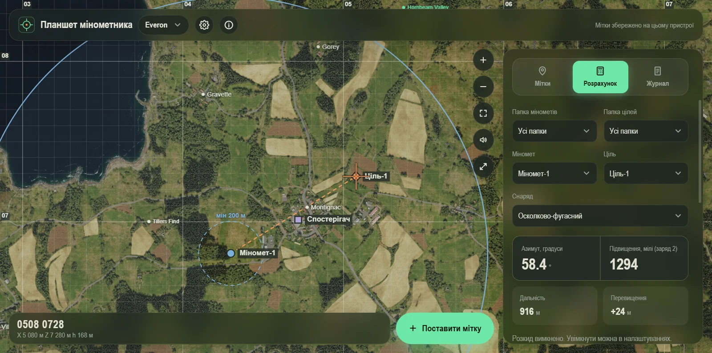

# Планшет мінометника

**Миттєвий розрахунок вогню міномета для Arma Reforger: просто на карті, у браузері й на телефоні.**

Постав міномет, постав ціль, і за секунду маєш азимут у мілах, кут підвищення, заряд і час польоту з урахуванням різниці висот.
Без таблиць, зошита й калькулятора: ти дивишся на карту, а не рахуєш.

**[Відкрити вебверсію](https://ingwalde.github.io/mortar-tablet/)** (працює в браузері, на телефоні встановлюється як застосунок)



## Чому це зручно

- **Карта під рукою.** Everon, Arland, Kolguyev і карти популярних модів (Gogland, Bad Orb, Bystrany, Kirovograd, Mogadishu, Iron Hold Castle, Novyinovka): масштабування, сітка з координатами, назви пунктів, контури будівель.
- **Приціл в один дотик.** Торкнувся будівлі, і приціл на ній; «Поставити мітку» ставить ціль точно в центр. Зруйновані цілі позначаються на карті.
- **Справжня балістика.** M252 і 2Б14, осколково-фугасний, освітлювальний і димовий снаряди, найкращий заряд (★), поправка на висоту, час польоту.
- **Видно, куди ляже.** Кільця дальності, лінія вогню, еліпс розкиду; постріл із анімацією польоту, гуркотом і влученням у момент прильоту.
- **Разом із командою.** Діліться мітками посиланням чи QR-кодом, дивіться й правте карту з телефона по Wi-Fi, ведіть журнал стрільби.
- **Зручно на телефоні.** Три темні теми, економний режим для слабких пристроїв, вібрація, екран не гасне.
- **Безкоштовно й відкрито.** Без реклами й реєстрації, некомерційний проєкт, код під MIT.

## Розробка

```bash
npm install
npm run dev
```

Відкриє Electron-вікно з hot-reload. Логи рендерера дублюються в консоль main-процесу.

## Тести

```bash
npm test          # vitest run (балістика, геометрія, тайли, висоти)
npm run typecheck # tsc --noEmit для main/preload і renderer/core
```

`scripts/check-places-local.mjs` і `scripts/test-import-module.mjs` — допоміжні
скрипти для ручної перевірки прив'язки карти й sharp-піраміди на реальних файлах
(потребують `maps/<terrain>_sat_*.png` у корені проєкту).

## Збірка

```bash
npm run dist:win    # portable .exe + NSIS-інсталятор -> dist/
npm run dist:mac    # dmg (потребує macOS)
npm run dist:linux  # AppImage + deb
```

Інсталятори для Windows і APK для Android з'являться у релізі 1.0.0; до того доступна вебверсія (її можна встановити як застосунок).

Готові файли після `npm run dist:win`:
- `dist/Планшет мінометника 0.16.2.exe` — portable, без інсталяції.
- `dist/Планшет мінометника Setup 0.16.2.exe` — інсталятор (NSIS).

### Windows: помилка розпакування winCodeSign

Якщо збірка падає на `Cannot create symbolic link` під час завантаження
`winCodeSign` — увімкніть Режим розробника (Параметри → Конфіденційність і безпека →
Для розробників). Це потрібно лише на машині, де відбувається збірка; на роботу
готового `.exe` в кінцевих користувачів не впливає.

## Перегляд з телефона (LAN)

У налаштуваннях (⚙) → «Мережа» → «Перегляд з телефона» увімкніть «Доступ з локальної мережі»: ПК підніме сервер (порт 8765), покаже посилання й QR-код. Телефон у тій самій Wi-Fi відкриває посилання в браузері (iPhone — Safari, Android — Chrome); встановлювати нічого не треба.

Щоб це виглядало як окремий застосунок (іконка, повний екран): iPhone — Safari → «Поділитися» → «На екран Додому»; Android — меню Chrome → «Установити застосунок». Іконки генерує `node scripts/make-icons.mjs`.

- Мітки, журнал і карта спільні між ПК і телефоном, зміни з’являються на іншому пристрої одразу; вибір міномета/цілі/снаряда й поточний терен кожен пристрій тримає свої.
- На телефоні панель знизу з бровкою: тягніть її вгору/вниз, тап ховає панель до бровки. Кнопка зі стрілками на карті ховає весь інтерфейс (повернути — та сама кнопка або Esc).
- Карти (імпорт, тайли) вантажаться з ПК; імпортувати карту можна лише в застосунку на ПК.
- Мітки й журнал зливаються за записами (за id і часом правки, видалення — надгробками): якщо ПК і телефон змінюють різні мітки одночасно, нічого не губиться.
- Телефон не гасить екран, поки планшет відкритий (Wake Lock, а по http — запасний прийом через приховане відео; вмикається першим дотиком).
- Доступ закритий випадковим ключем у посиланні (він лишається в адресі, щоб працював запуск з іконки — не діліться посиланням); «Новий ключ» анулює старі посилання. Сервер за замовчуванням вимкнений.
- Windows Firewall при першому вмиканні спитає дозвіл — оберіть «Приватні мережі».

### Офлайн-режим телефона (HTTPS)

Без ПК і Wi-Fi телефон працює через service worker, а iPhone дозволяє його лише на HTTPS. Тому застосунок сам створює локальний центр сертифікації (`lan-ca.json` у папці даних, закритий ключ не залишає ПК) і підписує ним сертифікат на IP-адреси ПК (порт 8766).

1. На ПК: «Перегляд з телефона» → у списку виберіть «Сертифікат довіри (одноразово)», відскануйте QR на iPhone, встановіть профіль (Налаштування → Профіль завантажено).
2. Налаштування → Загальні → Про пристрій → Довіра сертифікатам → увімкніть «Mortar Tablet Local CA».
3. Відкрийте посилання «… — офлайн (HTTPS)» в Safari й додайте на головний екран.
4. У застосунку на телефоні натисніть значок хмарки «Офлайн» → виберіть деталізацію → «Зберегти карту».

Що працює без ПК: сам застосунок, розрахунки, мітки й журнал (зберігаються на телефоні й зливаються з ПК, коли зв’язок повернеться), збережені тайли карти й висоти. Адреса сховища прив’язана до IP ПК: якщо IP змінився, збережене доведеться завантажити знову (краще задати ПК постійний IP).

На ПК в налаштуваннях → «Карти й дані» для Everon/Arland є «Карта без інтернету»: онлайн-тайли зберігаються на диск.

## Автономна версія (без ПК)

Той самий застосунок, зібраний як PWA (`npm run build:web` -> `out/web`): працює на телефоні без ПК і без Wi-Fi до ПК.
Мітки й журнал лежать у сховищі браузера на пристрої, обмін — файлом («Експорт…» / «Імпорт…» на вкладці «Мітки»).
Висоти вбудовані; тайли карт Everon/Arland/Kolguyev вантажаться напряму з їхнього першоджерела (потрібен інтернет), на сайт вони не копіюються.
Карти модів лежать на сайті. Імпорт власних карт — лише в застосунку на ПК.

- Публікація: workflow `.github/workflows/pages.yml` (GitHub Pages) — вручну або пушем у master зі змінами сайту.
- Локально: `WEB_SKIP_MOD_MAPS=1 npm run build:web` (без карт модів, швидко), далі будь-який статичний сервер на `out/web`.
- Що саме лежить на сайті (карти модів, висоти) — `src/core/webMirror.ts`; завантажене кешується в `.web-cache/`.

### Обмін мітками посиланням і QR (0.11)

«Експорт…» на вкладці «Мітки» тепер має «Копіювати посилання» і «Показати QR». Мітки стискаються й кладуться у фрагмент адреси
(`<сайт>#s=…`), сервер їх не бачить. Телефон наводить камеру на QR, відкривається веб-версія, імпорт пропонується сам (за потреби
перемикається карта). Посилання можна також вставити в поле «Імпорт…» («Вставити з буфера»). Дуже великі набори в QR не вміщаються:
тоді лишається посилання або файл. Формат і перевірки — `src/core/shareLink.ts`.

Примітка для iPhone: посилання відкриється в Safari, а встановлений на головний екран застосунок має окреме сховище; у такому разі
скопіюйте посилання й вставте в «Імпорт…» всередині застосунку.

### Звук пострілу й влучання

Звук синтезується WebAudio. Основна енергія пострілу й влучання лежить у басах, яких не відтворюють динаміки телефонів, тому додано гармоніки гулу
й середньочастотні шари. Перевірка без динаміків: відкрийте сайт з `?audiotest=1` і в консолі виконайте `await __mortarAudioTest(6)` (рендер у буфер).

### Зруйновані будівлі

Ціль чи точку можна позначити зруйнованою (✕ у списку або галочка в діалозі). Якщо мітка стоїть на будівлі (або впритул, до 3 м від стіни), на карті
ця будівля стає червоною разом із прибудовами, що торкаються її, з підписом «Зруйновано» посередині основного блоку; без контуру будівлі малюється червоний круг. Тап по червоній будівлі вибирає мітку,
а змінити чи повернути стан можна тими самими ✕/↺ або в «Змінити». Контури беруться з .topo світів і модів (секція BULD):
`node scripts/extract-buildings.mjs <id> <файл.topo> <розмір, м> src/core/buildings/<id>.ts`; для Iron Hold Castle даних немає.

### Налаштування (0.15)

Кнопка ⚙ у шапці відкриває екран налаштувань із розділами й пошуком (на телефоні розділи — смуга зверху). Кнопка «Скинути розділ» повертає типові значення розділу.

- **Вигляд:** тема (зелена/червона/синя), мова, назви пунктів (показ, розмір, важливість), кільця дальності, економний режим.
- **Звук і відгук:** звук пострілу (кнопка-гучномовець на карті лишилась), гучність, перевірка звуку, вібрація, «не гасити екран» (телефон і сайт).
- **Розрахунок:** розкид снарядів; доступні й типові снаряди для кожного міномета (вимкнені не показуються у списку «Снаряд», типовий підставляється при виборі міномета). Кільця (заряди) не налаштовуються: заряд обирається автоматично (★).
- **Карти й дані** (карта, прив'язка координат, менеджер завантажених даних — на ПК; збережені офлайн-карти — на сайті), **Мережа** (лише ПК), **Резервні копії**, **Оновлення й про програму** (сповіщення про нову версію — для сайту й Android).

Налаштування пристрою (тема, звук, вібрація тощо) не передаються між ПК і телефоном. Логіка вибору снарядів — `src/core/settings.ts`, екран — `src/renderer/settingsPanel.ts`.

### Приціл на будівлю і колірні теми

Тап по будівлі наводить приціл у її центр; будівля під прицілом підсвічується, а «Поставити мітку» ставить ціль точно в центр і називає її за найближчим
селищем («Montignac: Ціль 1», пункт до 500 м). Вибір теми — в налаштуваннях (⚙ → «Вигляд»): зелена (типова), червона й синя. Усі три теми завжди темні (системна світла/темна тема не використовується); червона й синя побудовані так само, як зелена:
ті самі співвідношення тонів, лише інший колірний тон. Кольори міток, сітка й сама карта лишаються звичайними. Вибір зберігається на пристрої (старий нічний режим 0.13 став червоною темою).

### Завантажені дані й вища роздільність

- **ПК:** ⚙ → «Карти й дані» → «Завантажені дані» → «Відкрити менеджер»: кеш онлайн-тайлів, імпортовані карти й висоти для кожного терену з розмірами та кнопками видалення.
- **Сайт (PWA):** офлайн-режиму карт нема: тайли Everon/Arland/Kolguyev беруться з першоджерела й на сайті не зберігаються (раніше збережене стирається автоматично). Офлайн-збереження лишилось у ПК-застосунку й у телефона, підключеного до ПК.
- **Novyinovka** тепер постачається разом із ПК-застосунком (`resources/maps/novyinovka`, повна піраміда 8192 px) і на сайті/в APK; власний імпорт має пріоритет.

### Розкид снарядів

⚙ → «Розрахунок» → «Розкид снарядів»: вмикач, режим «за даними гри» або два числа (% дальності) — вздовж лінії вогню й упоперек, окремо для M252 і 2Б14.
У вкладці «Розрахунок» лишається короткий підсумок радіусів і кнопка переходу до налаштувань.
На карті навколо цілі малюється еліпс (велика вісь уздовж вогню); радіуси також показано в метрах. У таблицях балістики розкиду нема, тому
значення задає користувач; за замовчуванням вимкнено. Розрахунки — `src/core/spread.ts`.

### Сповіщення про оновлення (0.11)

Веб-версія: коли service worker завантажив нову збірку, зверху з’являється «Оновити». Android-застосунок раз на пів доби перевіряє
останній реліз на GitHub і пропонує завантажити APK.

## Безпека

Рендерер у пісочниці з CSP, IPC перевіряється, LAN-сервер обмежує перебір ключа, локальний CA обмежений приватною
мережею, у збірці вимкнені небезпечні режими Electron. Подробиці й відомі обмеження — у [SECURITY.md](SECURITY.md).
Перевірка зібраного exe: `npm run smoke` (також у `npm run check`).

## Дані застосунку

Мітки, налаштування, кеш тайлів і дані висот зберігаються в
`%APPDATA%/mortar-tablet` (Windows) — не в localStorage.

## Ліцензія

Код застосунку — [MIT](LICENSE).

### Ліцензії джерел даних

Повний перелік (дані, моди, бібліотеки) і тексти ліцензій — у [THIRD-PARTY-NOTICES.md](THIRD-PARTY-NOTICES.md); у самому застосунку той самий текст
лежить у «Про програму» → «Ліцензії та подяки».

- [EnfusionMapMaker](https://github.com/nickludlam/EnfusionMapMaker) (nickludlam) — APL-SA: назви пунктів Everon/Arland, схема онлайн-тайлів.
  Ці дані (`src/core/terrains-data.json`) лишаються під APL-SA: лише некомерційно й лише для Arma. Код застосунку це не змінює.
- [GeNeFRAG/ArmaReforger](https://github.com/GeNeFRAG/ArmaReforger) — MIT: балістичні таблиці M252/2Б14, розміри теренів, супутникові знімки, дані висот.

Некомерційний проєкт, не пов'язаний з Bohemia Interactive.

## Формат тайлів карт

Імпортовані карти тепер нарізаються у **WebP** (раніше JPEG): файли на третину-половину менші при тій самій якості. Старі піраміди з JPEG працюють як є; щоб перевести їх у WebP, закрийте застосунок і запустіть `node scripts/convert-pyramids-webp.mjs` (`--keep` залишає оригінали, `--only=bystrany,mogadishu` обмежує набір карт).

## Швидкі збірки

| Команда | Що робить | Час |
|---|---|---|
| `npm run pack` | лише розпакований застосунок (`dist/win-unpacked`) | ~15 с |
| `npm run check` | typecheck + тести + `pack` + димовий тест зібраного застосунку | ~45 с |
| `npm run dist:setup` | тільки інсталятор NSIS | ~1 хв |
| `npm run dist:win` | інсталятор + portable (для релізу) | ~2,5 хв |

Для перевірки перед релізом достатньо `npm run check`; повну збірку роблять лише для публікації. Антивірус сильно сповільнює пакування (тисячі дрібних файлів): додайте `dist` і `node_modules` проєкту у винятки Windows Defender.
